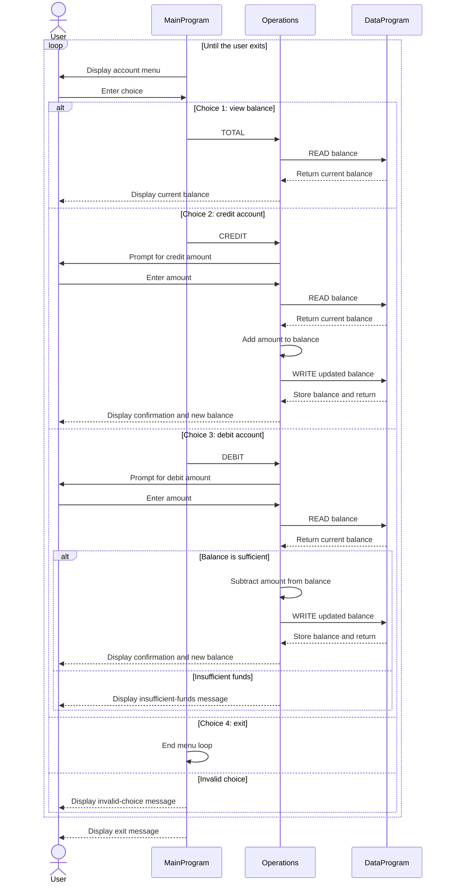

# COBOL Account Management System

This program is a small interactive account manager for a student account. It lets a user view the current balance, credit the account, debit the account, or exit.

## Source Files

- [`main.cob`](../src/cobol/main.cob): Defines `MainProgram`, displays the menu, reads the user's choice, and calls `Operations` for balance, credit, or debit actions. Choosing 4 exits the menu loop; other unsupported choices display an error.
- [`operations.cob`](../src/cobol/operations.cob): Defines `Operations` and implements the requested account action. It reads amounts for credits and debits, retrieves the current balance from `DataProgram`, applies an update when permitted, and displays the result.
- [`data.cob`](../src/cobol/data.cob): Defines `DataProgram`, which owns the account balance and provides `READ` and `WRITE` operations to retrieve or update it.

## Student Account Rules

- The account starts with a balance of 1,000.00.
- The balance is held in working storage, so it is maintained while the program runs but is not saved between program runs.
- A credit adds the entered amount to the balance.
- A debit is allowed when the current balance is greater than or equal to the entered amount. Otherwise, the program displays an insufficient-funds message and leaves the balance unchanged.
- The program does not validate that entered amounts are positive. As written, a negative credit or debit can therefore have the opposite effect of its label.
- Balances and transaction amounts use a numeric field with six integer digits and two decimal places (`PIC 9(6)V99`).

## Data Flow

